# ABMSynth: Advanced BMSynth

기존 BMSynth의 한계를 극복하고 BMSynth가 사용하는 BASS/BASSMIDI 라이브러리의 최신 기능을 적극적으로 접목하여 사운드폰트로 최상의 사운드 환경을 구현하고자 하는 프로젝트입니다.

Windows에서 MIDI 건반·악보 프로그램·MIDI 파일을 SoundFont로 연주합니다.
여러 음원에서 원하는 악기를 고르고, 채널과 효과를 조절하고, 직접 만든 소리를 악기로 사용할 수 있습니다.
기본 음원으로 **FluidR3 GM**을 동봉합니다.

**[다운로드](https://github.com/ruain-dev/ABMSynth/releases/latest)** ·
[시작하기](#시작하기) ·
[주요 기능](#주요-기능) ·
[문제 보고](https://github.com/ruain-dev/ABMSynth/issues)

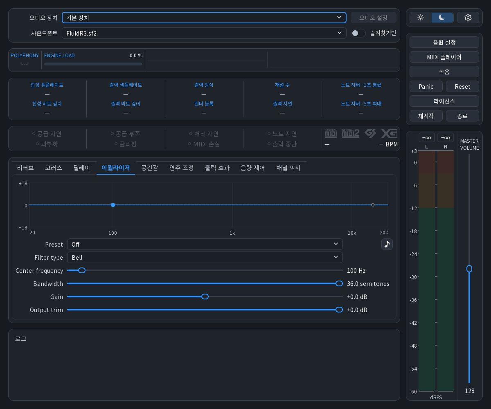

*메인 화면: 오디오 장치와 음원 선택, 연주 상태, 이퀄라이저, 출력 음량 조절.*

## BMSynth에서 확장한 기능

BMSynth의 [SoundFont 연주·음원 그룹·악기 조절](https://sites.google.com/site/propws/bmsynth-doc)을 출발점으로 삼았습니다.
ABMSynth에서는 악기를 직접 만들고, 채널과 효과를 조절해 연주하고, 결과를 MIDI와 오디오로 저장할 수 있습니다.

| 작업 | ABMSynth의 주요 기능 |
|---|---|
| **다양한 음원 구성** | SF2·SF3·SFZ, 동봉 FluidR3 GM, 음원 그룹과 악기별 선택, Bank LSB 배정 |
| **직접 악기 제작** | 샘플 편집·반복·음높이·템포 분석, 파형 그리기, 건반·연주 강도별 샘플 배정, SFG 저장 |
| **풍부한 효과 조합** | 출력 효과 **37종**, 채널별 효과 **28종**, 효과 순서·활성 상태·세부값과 그래프 조절 |
| **채널별 연주 제어** | 16채널 믹서, Mute·Solo, 음색·음량 윤곽·조율·페달·드럼 키별 조절, MIDI CC 배정·학습 |
| **MIDI 파일 감상·연습** | 내장 플레이어, 재생 목록·반복·셔플, 속도·음정 이동, 채널별 Mute·Solo |
| **녹음과 파일 제작** | MIDI 녹음, 오디오 녹음, 구간·잔향·품질을 정하는 오디오 내보내기, **7가지 저장 형식** |
| **여러 프로그램과 연결** | 자체 MIDI 드라이버, 외부 MIDI 입력·출력, 최대 **8개 포트·128채널**, 포트 이름 설정 |
| **연주 변화와 상태 확인** | 랜덤 타이밍·Velocity·동시성 보존, 코드·BPM 추정, 출력 피크·부하·지터·8가지 경고 |
| **출력과 화면 선택** | 공유·독점·ASIO, 고성능 합성, 합성 품질 설정, 라이트·다크 테마와 색상 팔레트 |

예를 들어 NWC에서 보낸 연주에 원하는 피아노와 현악기를 배정하고, 채널별 효과로 소리를 다듬을 수 있습니다.
MIDI 연습에서는 반주만 남기고 속도를 낮출 수 있습니다. 직접 녹음한 소리로 새 악기를 만들어 같은 연주에 사용할 수도 있습니다.

## 목차

- [BMSynth에서 확장한 기능](#bmsynth에서-확장한-기능)
- [다운로드](#다운로드)
- [시작하기](#시작하기)
- [주요 기능](#주요-기능)
  - [사운드폰트 그룹과 악기 배정](#사운드폰트-그룹과-악기-배정)
  - [악기별 기본값](#악기별-기본값)
  - [샘플로 악기 만들기](#샘플로-악기-만들기)
  - [파형을 그려 악기 만들기](#파형을-그려-악기-만들기)
  - [채널 믹서](#채널-믹서)
  - [채널 세부설정과 MIDI 배정](#채널-세부설정과-midi-배정)
  - [메인 효과 조절](#메인-효과-조절)
  - [출력 효과](#출력-효과)
  - [MIDI 플레이어와 오디오 내보내기](#midi-플레이어와-오디오-내보내기)
  - [MIDI 녹음과 오디오 녹음](#midi-녹음과-오디오-녹음)
  - [연주 조정](#연주-조정)
  - [MIDI 연결](#midi-연결)
  - [합성 품질과 고성능 합성](#합성-품질과-고성능-합성)
  - [연주 상태와 MIDI 모드](#연주-상태와-midi-모드)
- [화면 설정](#화면-설정)
- [문제 보고와 제안](#문제-보고와-제안)
- [감사와 출처](#감사와-출처)
- [소스와 사용 조건](#소스와-사용-조건)

## 다운로드

[최신 릴리스](https://github.com/ruain-dev/ABMSynth/releases/latest)에서 설치형 또는 포터블을 받으세요.

| 배포 형태 | 시작 방법 |
|---|---|
| **설치형** · `ABMSynth-1.0.0-Setup-x64.exe` | 설치 안내에 따라 설치하고 실행합니다. |
| **포터블** · `ABMSynth-1.0.0-Portable-x64.zip` | 쓰기 가능한 폴더에 압축을 풀고 `ABMSynth.exe`를 실행합니다. |

앱은 **Windows x64**용입니다. 자체 MIDI 드라이버는 **32비트·64비트 MIDI 프로그램**의 연결을 제공합니다.
ASIO 출력에는 장치에 맞는 ASIO 드라이버가 필요합니다.

## 시작하기

### MIDI 파일 듣기

1. 메인 화면의 **오디오 장치**에서 출력 장치를 선택하세요.
2. **사운드폰트**에서 동봉된 `FluidR3.sf2` 또는 사용할 음원을 선택하세요.
3. **MIDI 플레이어**를 열고 파일을 추가하거나 창에 끌어 놓으세요.
4. 재생을 누르고 **MASTER VOLUME**으로 음량을 조절하세요.

### MIDI 건반·악보 프로그램 연결하기

- **MIDI 건반이나 기존 가상 포트:** 환경설정의 **MIDI → 포트 연결**에서 외부 MIDI 입력을 선택하세요.
- **ABMSynth 자체 포트:** 환경설정의 **일반 → Windows MIDI 연결**에서 드라이버를 설치하세요. Windows 관리자 승인이 필요합니다.
  MIDI를 보낼 프로그램의 출력 장치로 **ABMSynth MIDI In**을 선택하세요.

ABMSynth에서 오디오 출력과 음원이 준비된 뒤 MIDI를 보내세요.
드라이버 설치 전에 열었던 MIDI 프로그램은 종료 후 다시 열어 장치 목록을 갱신하세요.
자체 드라이버 설치는 설치형·포터블 모두 Windows에 적용됩니다.
출력 방식은 Windows 공유·독점·ASIO 중에서 장치에 맞춰 선택합니다.

급히 울리는 음을 끝내려면 **Panic**, MIDI 연주 상태를 되돌리려면 **Reset**을 사용하세요.
각 조절부의 **기본값 복원**은 그 설정의 기준값을 불러옵니다.

## 주요 기능

### 사운드폰트 그룹과 악기 배정

**음원 설정 → 사운드폰트 그룹**에서 SF2·SF3·SFZ를 불러와 함께 사용합니다.
피아노는 한 음원에서, 현악기는 다른 음원에서 골라 곡에 맞는 악기 구성을 만들 수 있습니다.

- 음원별 음량을 조절하고, Bank·Program별로 사용할 음원을 선택합니다.
- **LSB 악기 배정**으로 Bank·Bank LSB·Program 주소에 악기를 연결합니다.
- 구성과 조절값을 **SFG**로 저장하고, NWC 등의 프로그램에서 사용할 악기 목록을 내보냅니다.

SFG에서 참조하는 외부 음원과 샘플은 그룹과 함께 보관하세요.
아래는 FluidR3의 악기를 주소별로 확인하는 배정 화면입니다.

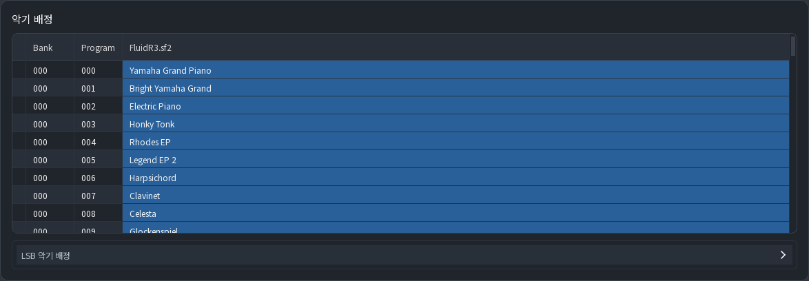

*악기 배정: Bank·Program별 악기 목록과 LSB 악기 배정.*

### 악기별 기본값

**음원 설정 → 악기 설정**에서 특정 악기의 기본 음색을 정합니다.
예를 들어 피아노의 음량을 낮추거나, 현악기의 시작을 부드럽게 만들 수 있습니다.

- 악기 음량, Cutoff·Resonance, Attack·Decay·Release를 조절합니다.
- 반응·조율·비브라토 등 악기별 기본값을 설정합니다.
- 미리듣기로 선택한 악기의 소리를 확인합니다.

이 기본값은 악기가 선택될 때 적용합니다. 이후 MIDI의 CC·조율 명령이 도착하면 해당 조절값을 갱신합니다.

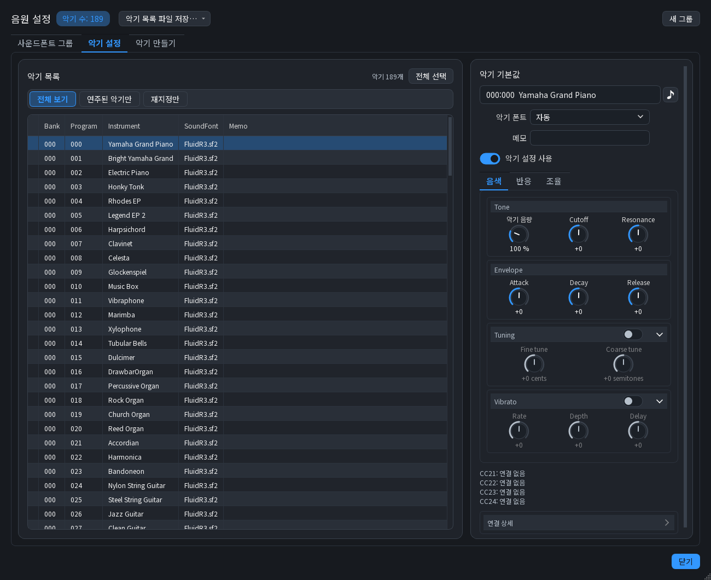

*악기 설정: 왼쪽에서 악기를 고르고 오른쪽에서 기본값을 조절합니다.*

### 샘플로 악기 만들기

**음원 설정 → 악기 만들기**에서 오디오 파일을 불러와 MIDI로 연주할 악기를 만듭니다.
전체 미리보기에서 위치를 찾고, 확대 파형에서 사용할 구간을 드래그해 선택합니다.

- **원본 편집:** 재생·반복 구간, 재생 속도, 음높이, 역방향, 샘플 음량을 조절합니다.
- **건반 배정:** 원음 건반과 재생 범위, 연주 강도 범위를 정합니다. 여러 샘플을 건반·강도에 나누어 배정할 수 있습니다.
- **악기 전체 조절:** 음량 윤곽, 필터, 비브라토·트레몰로로 악기의 반응을 조절합니다.
- **미리듣기:** 건반으로 연주하고, 조절 후 파형을 확대해 소리의 모양을 확인합니다.
- **음높이·템포 분석:** 측정 결과로 원음 건반을 지정하거나 템포를 맞춥니다. 일정한 음높이·박자를 판별하기 어려우면 측정 불가로 표시합니다.

이름과 악기 주소를 정해 **추가**하고 그룹을 SFG로 저장하세요.
샘플 파일은 **지정 경로 → SFG와 같은 폴더 → ABMSynth 실행 폴더** 순으로 찾습니다.
뒤의 두 위치에서는 해당 폴더 안의 파일을 확인합니다.

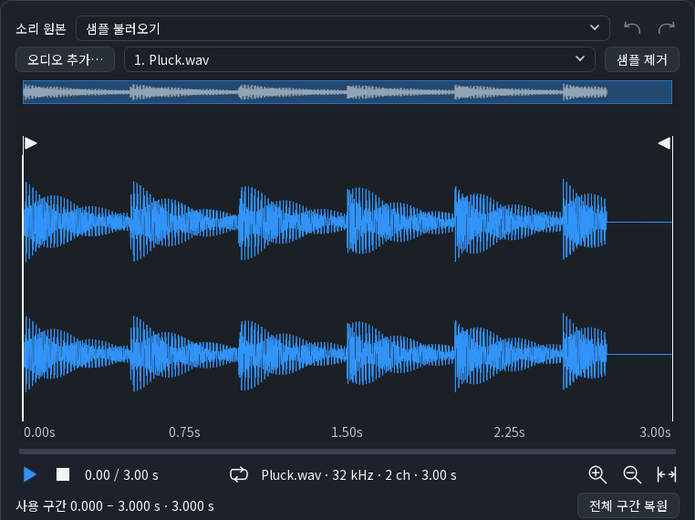

*샘플 편집 데모: 드래그로 구간 선택 → 포인터 위치를 기준으로 확대 → 전체 구간 복원.*

샘플 악기 편집 화면 전체 보기

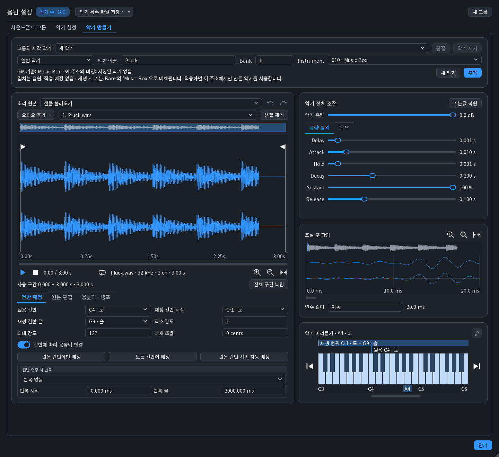

*악기 만들기: 왼쪽은 샘플과 건반 배정, 오른쪽은 악기 전체 조절·조절 후 파형·미리듣기.*

### 파형을 그려 악기 만들기

**소리 원본**에서 기본 파형을 고르거나 **직접 그리기**로 파형을 편집합니다.
그린 파형에도 음량 윤곽과 필터를 적용하고 건반으로 소리를 확인할 수 있습니다.

- 사인파 등 기본 파형에서 시작하거나 직접 원하는 모양을 그립니다.
- 원음 건반과 재생 범위를 정하고 악기 전체 조절로 음색을 다듬습니다.
- 완성한 악기를 그룹에 추가하고 SFG로 저장합니다.

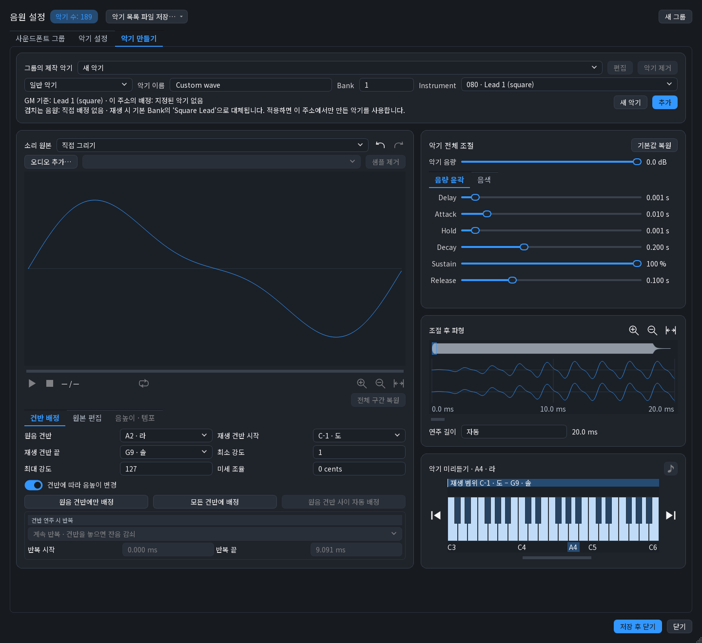

*직접 그리기: 편집한 원본 파형과 그 악기를 합성한 조절 후 파형.*

### 채널 믹서

**채널 믹서**에서는 16개 채널을 나란히 보면서 연주의 균형을 맞춥니다.
여러 MIDI 포트를 사용하면 확인할 포트를 선택합니다.

- 채널별 음량, Pan, Reverb·Chorus 전송량과 Pitch를 조절합니다.
- **M**으로 채널을 음소거하고, **S**로 선택한 채널을 따로 듣습니다.
- **PANIC**으로 해당 채널의 음을 끝내고, **편집**으로 세부설정을 엽니다.

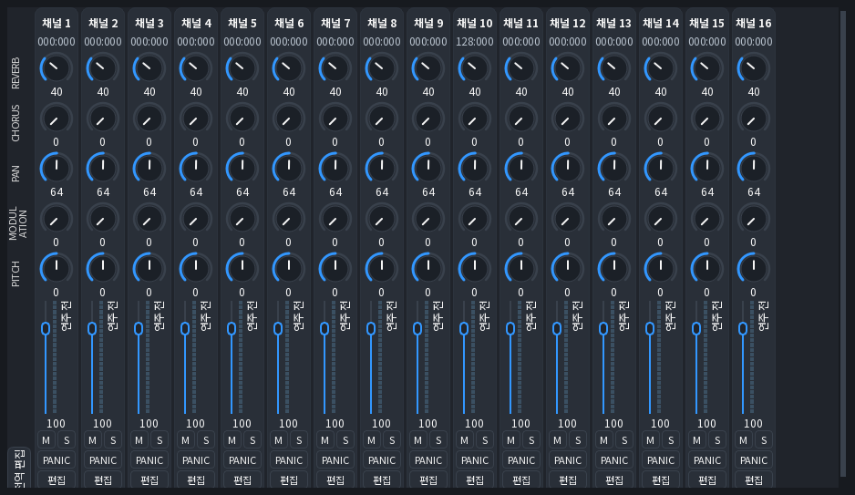

*채널 믹서: 채널별 노브·음량과 M·S·PANIC·편집 버튼.*

### 채널 세부설정과 MIDI 배정

채널 믹서의 **편집**에서 한 채널의 악기와 연주 반응을 자세히 조절합니다.
Bank·Bank LSB·Instrument로 악기를 고르고 다음 항목을 다룹니다.

- **음량·위치:** Volume, Expression, Pan, Mix level.
- **음색·연주:** 필터, 음량 윤곽, 비브라토, Portamento와 페달.
- **조율:** Pitch bend 범위, 미세 조율, 반음 이동과 음계별 조율.
- **드럼 키별 조절:** 킥·스네어·하이햇 등을 골라 음량·Pan·조율과 효과 전송량을 정합니다.
- **효과·배정:** Reverb·Chorus·Delay send, 채널별 오디오 효과, MIDI CC 배정·학습.

**SoundFont CC의 CC21~CC24**는 음원 제작자가 연결한 동작을 사용합니다. 연결 상태와 상세 내용을 확인할 수 있습니다.
드럼 채널의 별도 오디오 효과가 켜지면 드럼 음을 합쳐 처리하며 채널 전체 Reverb·Chorus·Delay send를 사용합니다.
킥·스네어 등의 음별 전송량을 쓰려면 그 채널의 별도 오디오 효과를 모두 끄세요.

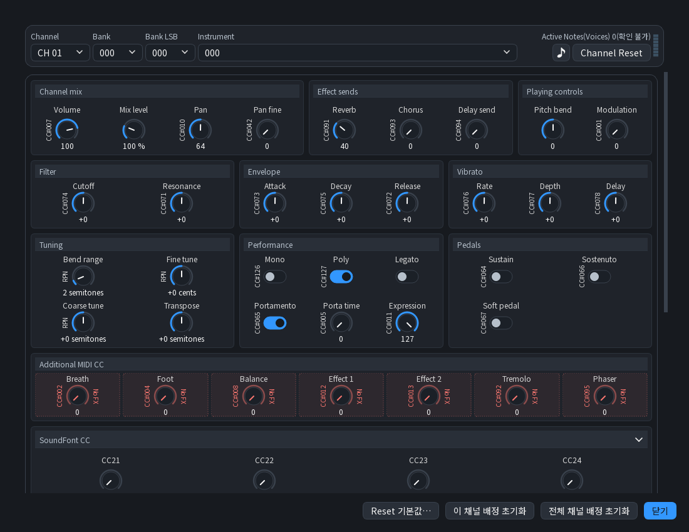

*채널 세부설정: 악기 주소와 음량·음색·연주·페달 조절부, MIDI 신호 배정 표시.*

### 메인 효과 조절

메인 화면의 **리버브·코러스·딜레이·이퀄라이저·공간감·음량 제어**에서 소리를 조절합니다.
프리셋으로 시작한 뒤 세부값을 바꾸고, 미리듣기로 소리의 변화를 비교하세요.

- **리버브·코러스·딜레이:** 잔향의 크기와 시간, 반복 간격과 음색을 조절합니다.
- **이퀄라이저:** 주파수별 강조·감소를 곡선으로 보며 조절합니다.
- **공간감:** 스테레오 확장으로 좌우 음상의 폭을 바꾸고, 공간감 효과의 처리 샘플레이트를 선택합니다.
- **음량 제어:** 컴프레서로 음량 차이를 다듬고 리미터로 출력 피크를 제한합니다.

아래는 리버브의 프리셋과 세부값을 조절하는 화면입니다.

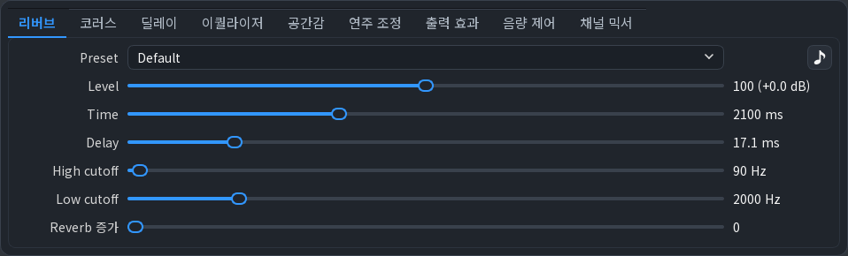

*메인 효과: 리버브 프리셋과 Level·Time·Delay 등 세부 조절부.*

### 출력 효과

**출력 효과**에서는 **37종**의 효과를 목록에 추가하고 순서를 바꾸어 조합합니다.
한 목록에 최대 32개 효과를 배치하고, 효과마다 활성 상태와 조절값을 정합니다.
채널 세부설정에서는 **28종**의 채널별 오디오 효과로 악기마다 다른 소리를 만들 수 있습니다.

| 조절 목적 | 효과 예시 |
|---|---|
| 특정 주파수 강조·감소, 음색 변화 | Parametric EQ, Low-pass filter, Distortion, Saturation, Bitcrusher |
| 음량 차이와 시간에 따른 음량 변화 | Compressor, Dynamic amplification, Noise gate, Volume envelope |
| 음량·음색에 반복적인 움직임 추가 | Chorus, DX8 Flanger, Phaser, Auto Wah, Tremolo |
| 잔향·반복음 추가 | Freeverb, DX8 Reverb, Echo, Convolution |
| 좌우 위치와 신호 조합 조절 | Auto pan, Stereo tools, Stereo matrix, Gain |

출력 효과 37종 전체 목록

- **음색·필터**: Parametric EQ, Low-pass filter, High-pass filter, Low shelf, High shelf, Distortion, DX8 Distortion, Saturation, Bitcrusher, Band-pass, Notch, All-pass, Pitch shift, DC blocker.
- **음량 변화**: Compressor, Dynamic amplification, Noise gate, Volume envelope.
- **변조**: DX8 Flanger, Phaser, Auto Wah, Chorus, DX8 Chorus, Tremolo, DX8 Gargle, Ring modulation.
- **공간·딜레이**: Freeverb, DX8 Reverb, Convolution, Headphone space, Echo, DX8 Echo.
- **스테레오**: Auto pan, Rotate, Stereo tools, Stereo matrix, Gain.

그래프가 있는 효과는 조절점을 움직이거나 곡선을 보며 값을 바꿀 수 있습니다.
미리듣기로 효과의 특성을 비교하세요. 파일을 사용하는 효과에는 사용할 임펄스 응답 등의 파일을 지정합니다.
아래는 EQ로 특정 주파수를 강조하고 Compressor·Echo를 함께 배치한 예입니다.

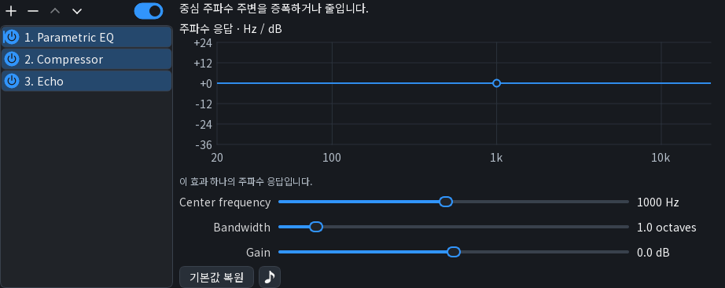

*EQ 데모: 조절점을 움직이면 응답 곡선과 주파수·Gain 값이 함께 바뀝니다.*

[출력 효과 고정 화면 보기](assets/screenshots/output-effects.png)

### MIDI 플레이어와 오디오 내보내기

MIDI 파일을 목록에 추가하고 **반복·셔플·재생 속도·음정 이동**으로 감상하거나 연습합니다.
재생 중인 곡의 BPM·박자·마디와 박, 트랙·채널 수를 확인할 수 있습니다.
오른쪽 채널 목록의 Mute·Solo로 특정 파트를 따로 듣습니다.

**음원 내보내기**에서는 현재 음원과 효과 설정으로 곡을 오디오로 만듭니다.
구간과 잔향 포함 여부, 샘플레이트와 저장 품질을 정합니다.
WAV·AIFF·FLAC·Ogg FLAC·Ogg Vorbis·Opus·MP3를 제공하며 형식에 맞는 비트 깊이·압축 설정을 선택합니다.

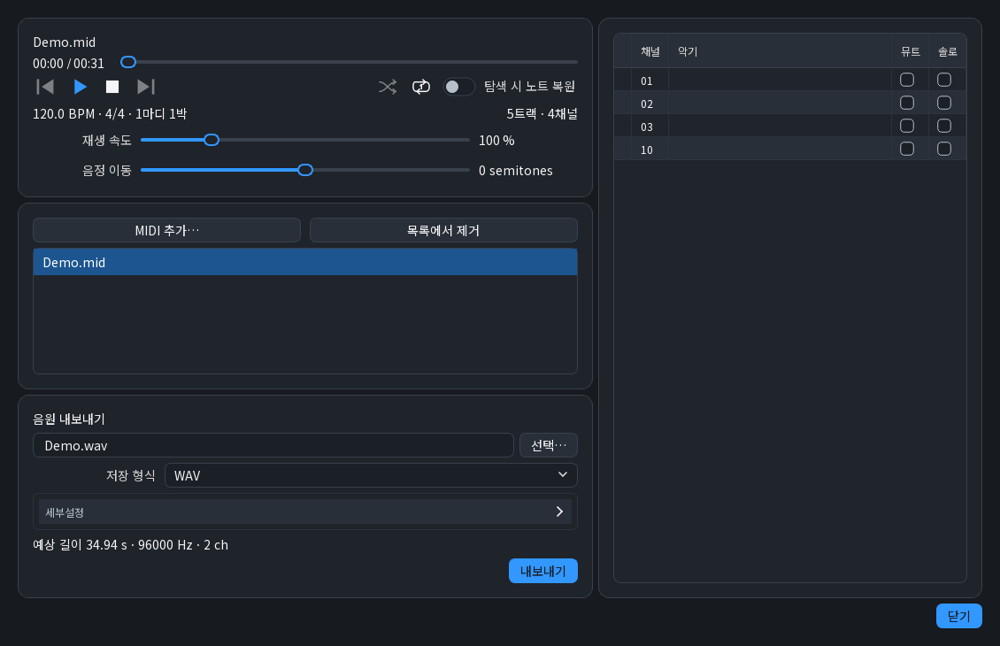

*MIDI 플레이어: 위쪽은 재생 조절, 왼쪽은 파일 목록과 내보내기, 오른쪽은 채널별 Mute·Solo.*

### MIDI 녹음과 오디오 녹음

메인 화면의 **녹음**에서 기록할 대상을 고릅니다. 녹음을 일시정지한 뒤 이어서 녹음하거나 파일로 저장할 수 있습니다.

- **MIDI 녹음:** 외부 MIDI 입력의 연주 정보를 `.mid`로 저장합니다. 이후 다른 음원과 효과로 다시 연주할 수 있습니다.
- **오디오 녹음:** ABMSynth의 음원과 효과가 적용된 소리를 오디오 파일로 저장합니다.

환경설정의 **녹음**에서 오디오 형식·품질과 저장 폴더·파일명을 정합니다.

### 연주 조정

**연주 조정**에서는 기준 음높이, Transpose, Velocity 반응을 바꿉니다.
미리듣기 버튼으로 기준음을 들으며 조율할 수 있습니다.

- **랜덤 타이밍:** 최대 300 ms 범위로 노트 시각에 변화를 줍니다. 파일 재생에는 앞뒤 시간 이동을 적용합니다.
- **실시간 입력:** 설정값만큼 기본 대기를 더해 시간 변화를 적용합니다. 100 ms 설정이면 실제 대기는 0~200 ms입니다.
- **동시성 보존:** 함께 시작한 노트 묶음에 같은 시간 변화를 적용합니다. 노트 시작 순서는 유지합니다.
- **랜덤 Velocity:** 최대 64 범위에서 연주 강도를 올리거나 낮춥니다. MIDI의 유효 범위 안에서 적용합니다.

조율용 기준음 버튼은 누르는 순간 켜지고, 다시 누르면 꺼집니다.
악기·효과의 음표 아이콘 버튼은 누르는 동안 연주합니다. 드럼 개별 음은 한 번 눌러 확인합니다.

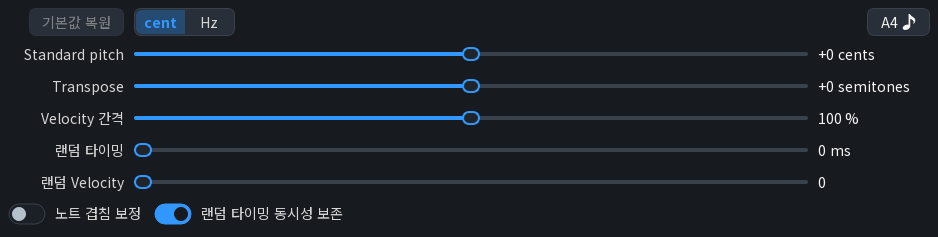

*연주 조정: 기준 음높이·Transpose·Velocity와 랜덤 타이밍·동시성 보존.*

### MIDI 연결

환경설정의 **MIDI**에서 자체 포트의 이름·개수와 외부 MIDI 입력·출력을 정합니다.
최대 **8개 포트**를 만들 수 있으며, 각 포트는 독립된 16채널을 사용해 총 **128채널**을 구성합니다.

- 다른 프로그램에서 ABMSynth로 보낼 때는 해당 포트의 **In**을 출력 장치로 선택합니다.
- 자체 출력 포트를 켜면 다른 프로그램의 입력 장치에서 해당 포트의 **Out**을 선택할 수 있습니다.
- MIDI 건반과 외부 가상 포트도 입력으로 사용할 수 있습니다.
- GM1·GM2·GS·XG 초기화 명령의 무시 여부를 모드별로 설정합니다.

환경설정의 **일반 → Windows MIDI 연결**에서 기본 출력 연결과 자체 드라이버의 설치·복구·제거 상태를 관리합니다.

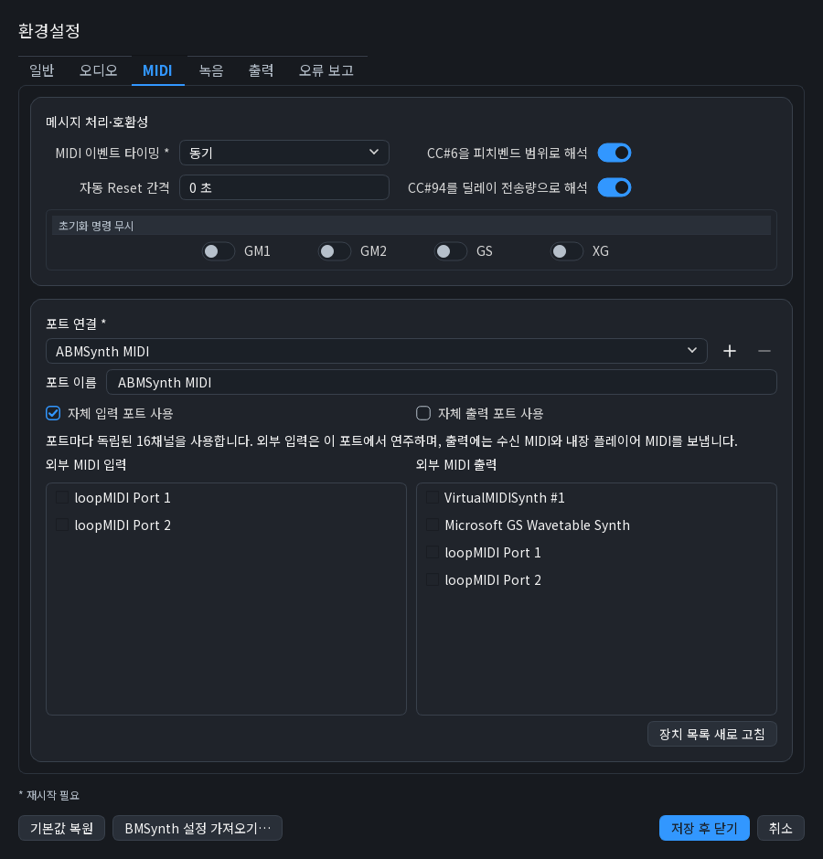

*MIDI 환경설정: 메시지 처리, 모드별 초기화 명령, 포트 이름과 외부 장치 연결.*

### 합성 품질과 고성능 합성

환경설정의 **오디오**에서 합성 샘플레이트, 샘플 보간, 악기 로딩 방식과 처리 옵션을 정합니다.
합성·출력 샘플레이트와 출력 지연은 메인 화면에서 확인할 수 있습니다.

**고성능 합성**은 채널별 합성을 16개 처리 스레드에 나누어 계산합니다.
여러 채널에 부하가 분산된 곡에서 처리 여유를 늘릴 수 있습니다.
CPU 사용량이 늘 수 있으며, 작은 잔음과 같은 음의 재연주 결과가 일반 합성과 달라질 수 있습니다.
기존 합성 결과를 유지하려면 고성능 합성을 꺼 두세요.

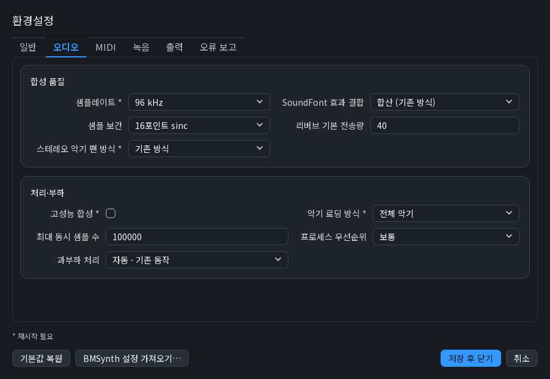

*오디오 환경설정: 합성 품질, 고성능 합성, 악기 로딩과 부하 처리.*

### 연주 상태와 MIDI 모드

메인 화면에서 동시 발음 수·ENGINE LOAD·파형·스펙트럼·출력 피크와 노트 지터를 확인합니다.
경고등은 공급 지연·공급 부족·처리 지연·노트 지연·과부하·클리핑·MIDI 손실·출력 중단의 관측 상태를 표시합니다.

GM1·GM2·GS·XG 로고는 MIDI 초기화 명령에 따라 현재 모드를 표시합니다.
로고를 눌러 수동으로 선택할 수 있으며, 이후 모드 명령도 계속 반영합니다.
켜진 로고를 다시 누르면 Default로 돌아갑니다. 실제 악기 소리는 사용하는 음원과 배정에 따라 결정됩니다.

로고 아래에는 연주에서 추정한 **코드와 BPM**을 표시합니다.
추정값은 연주를 파악하는 참고 정보로 활용하세요. 판단할 수 없으면 `—`로 표시합니다.

*재생 대기 중의 경고등과 모드 로고, 추정 코드·BPM 표시 위치.*

## 화면 설정

메인 화면 오른쪽 위에서 라이트·다크 테마를 전환합니다.
톱니바퀴 버튼으로 환경설정을 열어 색상 팔레트와 동작을 정할 수 있습니다.
`*`가 붙은 항목은 저장 후 재시작하면 적용됩니다. BMSynth 설정 가져오기도 제공합니다.

라이트 테마 화면

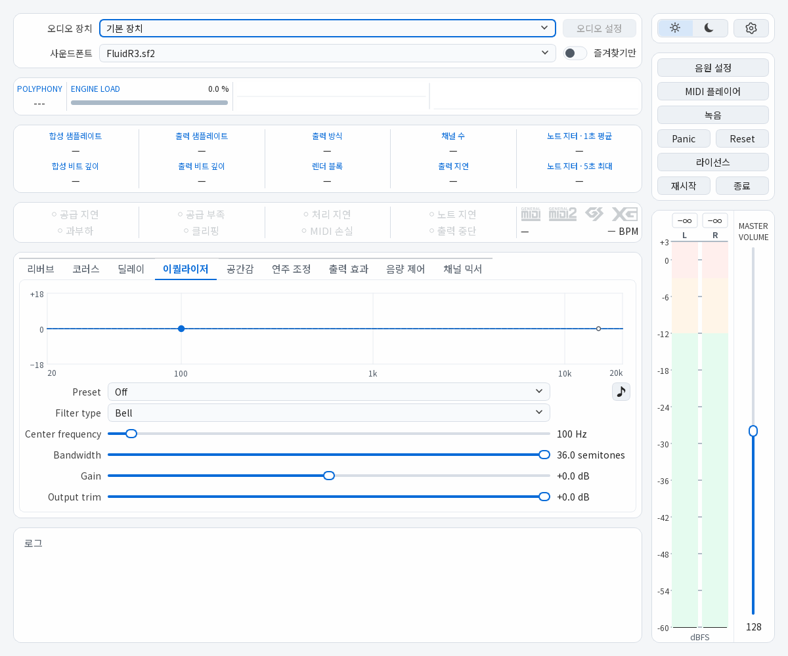

*다크 테마와 같은 메인 화면을 라이트 테마로 표시한 예.*

## 문제 보고와 제안

[Issues](https://github.com/ruain-dev/ABMSynth/issues)에 재현 순서와 기대한 동작을 적어 주세요.
앱 버전·Windows 버전·출력 장치와 방식·음원 또는 파일 형식을 함께 알려 주면 도움이 됩니다.
환경설정의 **오류 보고**에서 상세 기록을 시작하고, 문제 발생 후 보고 자료로 저장할 수 있습니다.
메인 로그의 표시 수준과 반복 경고 표시 방식도 환경설정에서 조절합니다.

공개할 보고 자료의 파일 경로·장치 이름을 확인하고, 공유할 권한이 있는 음원·샘플·악보를 첨부하세요.

## 감사와 출처

- **모티브 — propws의 [BMSynth](https://sites.google.com/site/propws/bmsynth-v1-6-9).**
  SoundFont로 MIDI를 연주하고 여러 음원을 구성하는 BMSynth의 사용 경험에서 출발했습니다.
- **핵심 음향 기술 — Ian Luck 및 [Un4seen Developments](https://www.un4seen.com/bass.html).**
  **BASS**는 오디오 재생과 효과 처리를, **[BASSMIDI](https://www.un4seen.com/bass.html#addons)**는 SoundFont 합성과 MIDI 연주를 담당합니다.
- **기본 음원 — Frank Wen의 FluidR3 GM.**
  동봉 음원의 원문 안내와 사용 조건은 [FluidR3 고지](dev/licenses/fluidr3/README)와 [라이선스](dev/licenses/fluidr3/COPYING)에서 확인할 수 있습니다.

이 프로젝트의 모티브와 핵심 라이브러리, 음원을 만들어 주신 제작자들께 감사드립니다.
외부 구성요소의 전체 고지는 앱의 **라이선스** 창과 [고지 문서](dev/THIRD_PARTY_NOTICES.md)에 있습니다.

## 소스와 사용 조건

소스 실행·빌드 방법은 [BUILDING.md](BUILDING.md), 기여 안내는 [CONTRIBUTING.md](CONTRIBUTING.md)를 참고하세요.
릴리스의 `ThirdPartySources.zip`에는 외부 구성요소의 소스 자료가 있으며, `SHA256SUMS.txt`로 다운로드 파일의 해시를 대조할 수 있습니다.

ABMSynth 자체 코드와 자체 자산은 **PolyForm Noncommercial 1.0.0**과 음악 제작 추가 허용을 따릅니다.
**음악 제작·음원 판매·수익형 방송·유료 공연·유료 스튜디오 작업에 사용할 수 있습니다.**
프로그램 판매·상용 제품 편입은 해당 라이선스와 별도 허가 범위를 확인하세요.
음원·샘플·외부 라이브러리에는 각 원래의 사용 조건이 적용됩니다.

[LICENSE](LICENSE) · [음악 제작 추가 허용](ADDITIONAL_PERMISSIONS.md) · [한국어 안내](LICENSE-POLICY.md)

제작: [ruain](https://github.com/ruain-dev)
